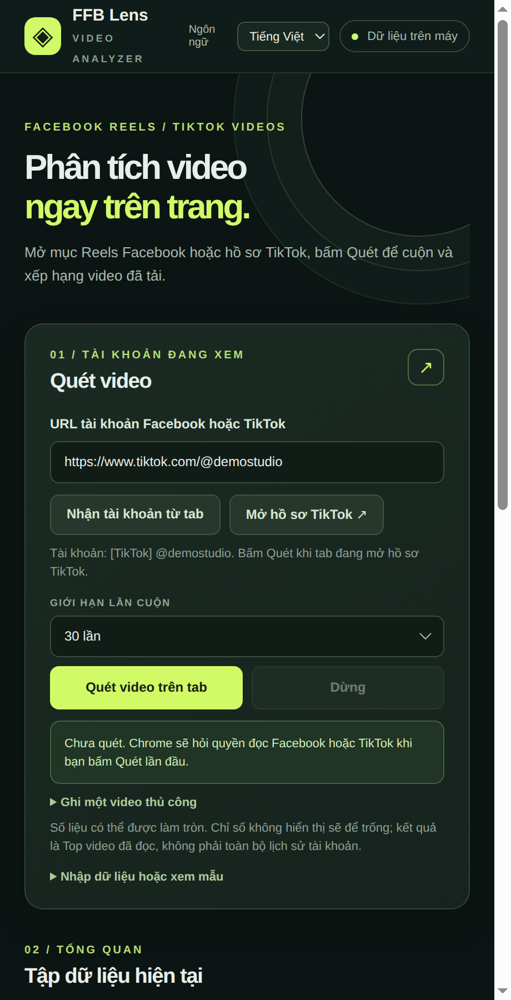
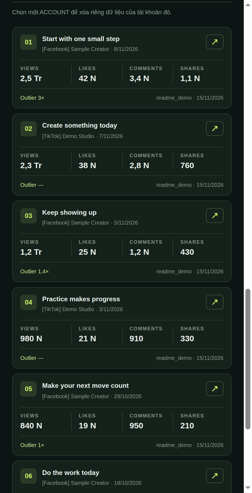

# FFB Lens — Facebook Reels and TikTok Video Analyzer

FFB Lens is a Manifest V3 Chrome extension with a side panel for Facebook Reels and TikTok profile videos. It scrolls the open Facebook Reels tab or TikTok profile, reads video cards and data already loaded in that tab, and ranks the results locally. CSV import and manual entry are secondary options. The interface supports Vietnamese and English and remembers the selected language locally. Data is processed and stored in IndexedDB on the device; it is not sent to an FFB Lens server.

## What you can do

- Scan a Facebook Page or profile Reels tab, or a TikTok `@username` profile, with a limit of 10–100 scrolls. Stop early or rescan to update saved records without duplicating videos.
- Select Top N videos by views, likes, comments, shares, or posted date, then optionally reorder that Top N by another criterion. Add a final tie-breaker; filter by account, date, source, and minimum views; inspect summary statistics and Outlier Score.
- Recognize accounts by their Facebook or TikTok display name when available. `[Facebook]` and `[TikTok]` labels distinguish platforms in the account selector, status, and video cards.
- Keep results on your device. Delete one selected account's saved videos, or export the displayed results to CSV/XLSX. Manual entry and CSV import are available when needed.

## Interface preview

These screenshots show version 0.7.3 with fictional accounts and synthetic data. The numbers illustrate the interface; they are not measurements from live Facebook or TikTok scans.

| Set up a profile scan | Compare videos from both platforms |
| --- | --- |
|  |  |

## Install and run

Requires Node.js 20.19+ or 22.12+ and Chrome 114+.

```bash
npm install
npm test
npm run build
```

1. Open `chrome://extensions` in Chrome and enable **Developer mode**.
2. Choose **Load unpacked** and select this project's `dist` directory.
3. Open the Facebook Reels tab or TikTok profile you want to analyze. Recognized URL forms include `facebook.com/<username>/reels/`, `facebook.com/profile.php?id=<id>&sk=reels_tab`, `facebook.com/people/<name>/<id>/reels/`, and `tiktok.com/@<username>`.
4. Click the **FFB Lens** toolbar icon to open the side panel. The extension reads the account URL from the tab; use **Use account from tab** if needed. If Chrome has not granted access to that tab's URL, this button asks for Facebook/TikTok site access before reading the URL.
5. Select a limit of 10–100 scrolls, click **Scan videos on tab**, and grant access to the selected platform when Chrome asks for it the first time. The extension reloads the tab once to capture data available when the page loads, then scrolls it. The side panel updates video counts, data coverage, and rankings during the scan. Click **Stop** to end early. DevTools and console commands are not needed.
6. Choose **English** from the **Language** menu at the top of the side panel if desired. After scanning, **ACCOUNT** shows `[Facebook]` or `[TikTok]` before the display name when the selected platform provides it; the same label appears in account status and video cards. Accounts with the same name on one platform also show their URLs in **ACCOUNT**. Rescanning updates older saved videos for that account. The account URL or ID remains the stable key. Selecting an **ACCOUNT** updates the account URL field and its profile link; **All accounts** clears the field. Use filters, statistics, or manual entry when metrics are missing. CSV import is under **Import data or view sample**.
7. Choose **Select Top by**, **Top**, then optionally **Reorder Top by**. For example, **Most shares → Top 10 → Newest** selects the ten most-shared videos from the filtered data, then shows only those ten in newest-first order. **Break ties by** applies only when two videos match on the reorder criterion. Videos with missing values rank last at the relevant step. The displayed order is also used in CSV/XLSX exports.

`npm run dev` serves the UI in a browser for quick development. To test extension behavior, run `npm run build`, load `dist` in `chrome://extensions`, and click **Reload** on the extension card after each new build. Run `npm run package` when you need a ZIP in `release/`.

## Architecture

```
public/manifest.json       MV3 manifest; sidePanel, activeTab, scripting, optional Facebook/TikTok host access
public/service-worker.js   opens the side panel when the extension icon is clicked
src/main.ts                dashboard, scanning, import, filters, and export
src/i18n.ts                English UI and error-message translations
src/data/csv.ts            CSV parsing, writing, and column mapping
src/data/normalize.ts      counts, URLs, dates, and Reel identity
src/data/engine.ts         deduplication, filtering, ranking, and statistics
src/data/sources.ts        source contract, CSV adapter, and ingestion validation
src/data/manual-page.ts    account URL context and manual Reel entry
src/facebook/content.ts    visible Reel cards and bounded tab scrolling
src/facebook/context.ts    Page and profile Reels URL recognition
src/facebook/extract.ts    Reel URL and visible metric extraction
src/facebook/observer.ts   observes GraphQL responses already loaded in the Reels tab
src/facebook/graph.ts      extracts Reel URLs, captions, dates, and metrics from those responses
src/facebook/name.ts       resolves Facebook display names for saved accounts
src/tiktok/context.ts      TikTok profile and video URL recognition
src/tiktok/parse.ts        extracts video metrics from TikTok data loaded in the tab
src/tiktok/observer.ts     observes TikTok video responses already loaded in the profile tab
src/tiktok/content.ts      reads visible video cards and scrolls the profile tab
scripts/build-content.mjs  builds MV3 content scripts separately
src/data/db.ts             local IndexedDB storage
src/data/xlsx.ts           local XLSX generation
public/sample-reels.csv    synthetic UI test data, not real Facebook data
public/privacy.html        Vietnamese privacy page included in the extension
public/privacy-en.html     English privacy page included in the extension
```

The processing layer accepts `Reel` records, so a permitted data source can be added later without changing the ranking algorithms.

The [Phase 4 research report](docs/facebook-integration-research.md) records Facebook access and API limitations. Scanning starts only when the user clicks Scan on a supported tab. The extension observes responses the platform has already loaded; it does not make its own Facebook or TikTok API requests, read cookies, or bypass access controls. See the [privacy policy](docs/privacy.md) and [release checklist](docs/release-checklist.md).

## When a scan finds no results

- Read the status line below the Scan button. If Chrome asks for access to Facebook or TikTok, choose **Allow**. If access is denied, Scan reports the missing permission.
- If the status shows **0 candidate links**, confirm that the tab shows the account's Reels grid, wait for it to load, and scan again. If links are present but **0 Reels** are found, Facebook may have changed its Reel URL format. Capture the Reels grid and status line for diagnosis. For profiles, include the URL shape with the name or ID redacted if needed.
- If Reels are found but **0 have views**, the extractor has not recognized how Facebook displays views on that account. Do not invent missing numbers.
- If views are found but **0 Reels have Facebook response data**, the observer has not recognized that account's response structure. Posted dates, likes, and comments may remain blank; capture the status line for further diagnosis.
- The scan status now shows how many videos have Share counts. A visible Share count on an opened Reel does not establish that Facebook included it in the Reels grid response. If Share coverage stays at zero, capture the relevant GraphQL response for one opened Reel with sensitive fields removed; see [Share count research](docs/facebook-share-research.md).
- On TikTok, scan the public `tiktok.com/@username` profile itself. If video tiles show views but likes, comments, shares, or dates remain blank, TikTok may not have loaded those fields into the tab. Capture the profile URL shape and the scan status for diagnosis. This path needs a live profile check in a logged-in browser.
- `Permissions-Policy` warnings and the `Stop!` message in DevTools Console are emitted by Facebook when the console opens; they are not FFB Lens errors. Do not paste code into the console.

## CSV format

The `reel_url` column is required. Other columns are optional:

`page_name,page_url,reel_id,reel_url,caption,views,likes,comments,shares,published_at,collected_at,source`

Comma, semicolon, and tab delimiters are supported, along with a UTF-8 BOM, quoted fields, and multiline cells. Counts such as `1.2K`, `2.5M`, `1,2 trieu`, and `1,234` are normalized. Invalid or missing values remain blank. Dates may use ISO format or `dd/mm/yyyy`. Rows without a valid HTTP(S) video URL are skipped. The account URL entered in the UI supplies `page_url` only when that CSV field is blank. TikTok video URLs use the same `reel_url` CSV field for compatibility with existing exports.

## Manual test checklist

1. On a Page or profile Reels tab, open the side panel and confirm that the account URL is recognized. Select 10 scrolls and click **Scan videos on tab**. Check that the video count grows and that each result opens its original video.
2. Compare several Reels with Facebook and, for a matching Page, a SortLens export. Check posted dates, likes, comments, and the response-data count in the status line. Unavailable metrics must stay blank; rounded values such as `1.2M` are approximate. Stop and rescan to verify that Reels are not duplicated.
3. To test sample data, open **Import data or view sample**. The sample contains six Reels; its Vietnamese 1.2-million count should parse as 1,200,000.
4. Switch between Top 10 and Top 20, select Top by shares, then reorder the chosen videos by date. Confirm that videos outside the selected Top N do not enter after reordering. Try the tie-breaker and the 7/30/90-day, custom date, account, source, and minimum-view filters.
5. Check the six summary cards, the most-viewed Reel, and Outlier Score. Outlier scores should appear for sample Reels with enough view data in the same account cohort.
6. Export CSV and XLSX, then check row order, row counts, source columns, and `outlier_score` in both files.
7. Close and reopen the side panel to confirm that IndexedDB records remain. Select an **ACCOUNT**, then use **Delete account data** to remove only that account's saved videos. The button is disabled for **All accounts**. The confirmation counts every saved video for that account, including videos outside the current search, time, source, and Top filters.
8. If Facebook changes its DOM, record the account URL, a screenshot of a Reel card, and the visible metric for extractor updates. End-to-end behavior on a logged-in profile has not yet been verified in this environment.
9. On a TikTok profile, confirm the first video tile, another tile loaded after scrolling, and the corresponding records in the side panel. Open a video to compare available metrics. TikTok end-to-end behavior has not yet been verified in this environment.

## Scope and limitations

- Implemented: bounded Facebook Page/profile Reels and TikTok profile video scans, visible URL/metric extraction, observation of platform responses already loaded in the tab, stop controls, deduplication, ranking, filters, statistics, local storage, manual entry/CSV import, and CSV/XLSX export.
- Not implemented: verification of an account's complete Reel history, the official Meta Graph API, or video image/audio analysis. The AI feature was removed.
- Limits: Facebook and TikTok can change their DOM or response structures, and metrics may be rounded or missing. TikTok profile tiles often expose views only; likes, comments, shares, and dates require those fields to be present in data already loaded by the tab. The TikTok path has not yet been checked on a logged-in live profile in this environment. Top N covers **videos read within the chosen scroll limit**, not an account's full history. Share counts on Facebook often appear only after opening an individual Reel. CSV input is limited to 20 MB, and the list shows at most 100 rows.

### Outlier Score

`Outlier Score = Reel views / median views of Reels from the same account in the selected period`. It is calculated only when the cohort has at least five Reels with views and a median above zero. The cohort uses the stored data and is unaffected by search, source, minimum views, and Top, so changing those filters does not change a Reel's score. Reels without an account or views have no score. Insufficient data is shown as `—` and exported as a blank value.

## Facebook access notes

1. Prefer exports or data provided by an account owner with confirmed usage rights; retain `source` and `collected_at`.
2. Before designing an official Meta Graph API connector, determine the account type, permissions, and approved features. Access to an owned Page and access to another Page's public content are different cases; do not assume the API returns every Reel's views.
3. The content script reads the DOM and Reel responses Facebook has already loaded in the open tab, then scrolls after the user clicks Scan. [Meta states that automated collection from its products requires permission](https://about.fb.com/news/2021/04/how-we-combat-scraping/). Chrome's `activeTab` permission does not grant Meta permission. Confirm the applicable terms before release or broad use.

References: [Chrome Side Panel API](https://developer.chrome.com/docs/extensions/reference/api/sidePanel), [Chrome Manifest](https://developer.chrome.com/docs/extensions/reference/manifest), [Meta Page API](https://developers.facebook.com/docs/graph-api/reference/page/), [Meta Page Feed](https://developers.facebook.com/docs/graph-api/reference/page/feed/), and [Meta on automated collection](https://about.fb.com/news/2021/04/how-we-combat-scraping/).
